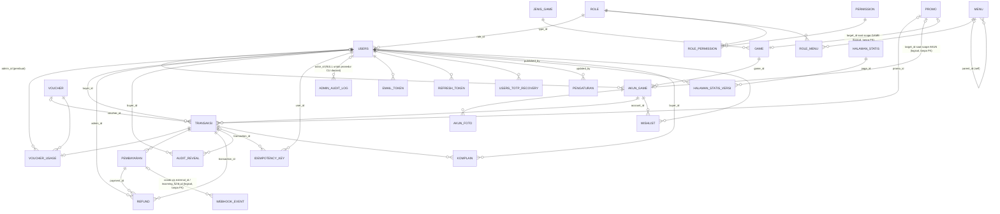
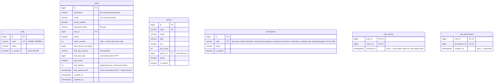
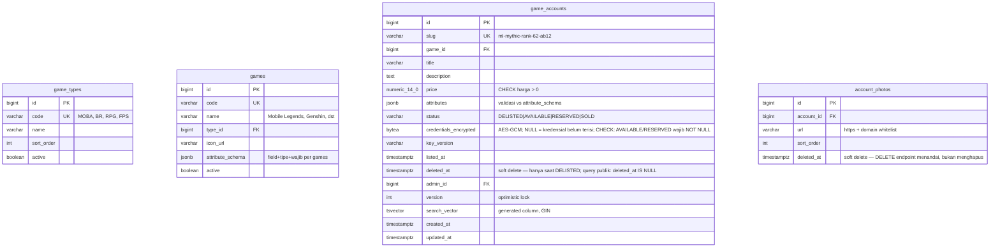
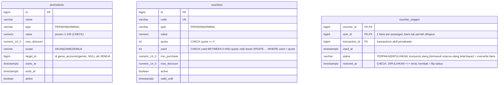
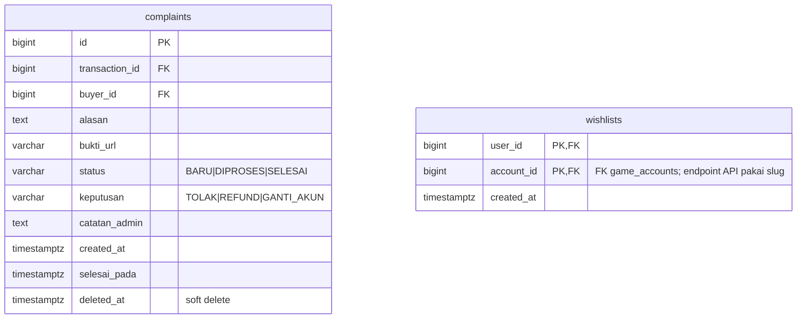
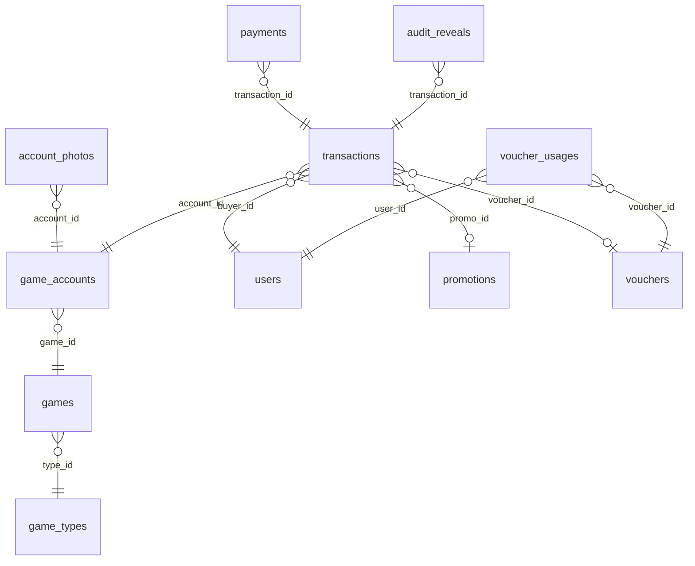

# 🗂 ERD — Toko Online Akun Game (v11)

> Entity Relationship Diagram untuk skema database (PLAN.md §6, v10).
> **30 tabel**: MVP = 28 🟢 · Fase 2 = 2 (ditandai 🔵).
> **Kebijakan soft delete (v8)**: rekord bisnis tidak pernah dihapus fisik — penanda
> `deleted_at` / flip `status` / flip `active` (tabel master) / `revoked_at`;
> **pengecualian: tabel audit** (`admin_audit_logs`, `audit_reveals`) dan `static_page_versions`
> tidak bisa dihapus sama sekali. Data teknis sementara (`refresh_tokens`, `email_tokens`)
> dibersihkan `RetensiJob` (PLAN §6 "Retensi data").
> Diagram memakai Mermaid `erDiagram` — Renderer: GitHub / VS Code / mermaid.live.

Konvensi:
- `PK` = primary key, `FK` = foreign key, `UK` = unique
- Rupiah `numeric(14,0)` · waktu `timestamptz` · soft delete lewat `deleted_at`
- Development memakai satu `DATABASE_URL`; production sebaiknya memisahkan user aplikasi **DML-only** dan Prisma Migrate **DDL**

---

## 1. Overview Relasi Antar-Kelompok

```
┌─────────────┐      ┌──────────────────────┐      ┌──────────────────┐
│ RBAC/users  │◄────►│ Transaksi & Bayar    │◄────►│ Katalog          │
│ 6 tabel     │      │ 6 tabel              │      │ 4 tabel          │
└─────────────┘      └──────────────────────┘      └──────────────────┘
       │                     │        │
       │                     ▼        ▼
       │             ┌────────┐  ┌─────────┐
       └────────────►│Diskon 3│  │Sistem 8 │ (themes, settings, email_tokens, refresh_tokens,
                     └────────┘  └─────────┘  audit-log, halaman(+versi), totp_recovery)
                                          ▼
                                    Fase 2: complaints 🔵, wishlists 🔵
```

---

## 2. ERD Lengkap (Satu Diagram)



---

## 3. Detail Entitas

### 3.1 RBAC & Pengguna (6 tabel)



### 3.2 Katalog (4 tabel)



State machine `game_accounts.status`:

```
DELISTED (draf) ──relist()──► AVAILABLE ──delist()──► DELISTED
   (relist wajib kredensial)      │  ▲
                         reserve()│  │release()   (transactions EXPIRED / FAILED / CANCELLED)
                                  ▼  │
                               RESERVED ──markSold()──► SOLD
                                                         │
          pulihkan() (Fase 2; wajib ganti kredensial) ◄──┘  ──► AVAILABLE
```

### 3.3 Diskon (3 tabel)



Urutan diskon: `initial_price − promotion_discount − voucher_discount = total > 0` (diskon Strategy; promotions paling spesifik menang: AKUN > GAME > SEMUA; seri pada tingkat yang sama → potongan rupiah terbesar, seri lagi → `id` terbesar; potongan persen dibulatkan ke bawah/floor ke rupiah penuh).

### 3.4 Transaksi & Pembayaran (6 tabel)

```mermaid
erDiagram
    transactions {
        bigint id PK
        varchar code UK "acak; dasar external_id per tagihan (lihat payments.external_id)"
        bigint account_id FK
        bigint buyer_id FK
        numeric_14_0 initial_price "snapshot harga akun"
        bigint promo_id FK "nullable"
        numeric_14_0 promotion_discount
        bigint voucher_id FK "nullable"
        numeric_14_0 voucher_discount
        numeric_14_0 total "CHECK > 0"
        varchar status "RESERVED|PAID|EXPIRED|FAILED|CANCELLED|NEEDS_REFUND|REFUNDED|DISPUTED"
        text note
        int terms_version "persetujuan S&K → static_page_versions (syarat-ketentuan, versi ini)"
        timestamptz terms_accepted_at
        boolean receipt_confirmed
        timestamptz confirmed_at
        varchar confirmed_by "PEMBELI|OTOMATIS; CHECK: receipt_confirmed = (confirmed_at IS NOT NULL) = (confirmed_by IS NOT NULL)"
        timestamptz reveal_until
        timestamptz warranty_start "reveal pertama, atau paid_at + 30 hari bila tak pernah reveal (diisi job)"
        int version "optimistic lock"
        timestamptz created_at
        timestamptz expired_at
        timestamptz paid_at
    }
    payments {
        bigint id PK
        bigint transaction_id FK
        varchar method "QRIS|VA"
        varchar external_id UK "kode transactions + nomor urut tagihan (mis. TRX-1); dikirim ke Xendit; kunci pencocokan webhook/rekonsiliasi"
        varchar xendit_id "ID tagihan; index, BUKAN unique"
        varchar incoming_fund_id UK "ID dana masuk dari callback; NULL sebelum bayar; dasar DUPLIKAT"
        varchar status "PENDING|PAID|EXPIRED|FAILED|CANCELLED|DUPLIKAT"
        varchar reference "kode bank untuk VA; NULL untuk QRIS"
        jsonb instructions "qr_string/nomor VA + expiry dari provider"
        numeric_14_0 amount
        timestamptz expired_at
        timestamptz created_at
    }
    idempotency_keys {
        varchar key PK "header Idempotency-Key; PK gabungan (user_id, key)"
        bigint user_id PK,FK
        bigint transaction_id FK
        varchar status "PROCESSING (TTL 5 menit)|SELESAI|KEDALUWARSA"
        varchar request_hash "hash(metode + path + body); key sama isi beda ? 422"
        int response_status
        jsonb response_snapshot "respons sama diulang, termasuk respons error final; NULL setelah masa retensi"
        timestamptz valid_until "klaim baris kedaluwarsa = overwrite"
        timestamptz created_at "job pembersih menandai KEDALUWARSA, bukan hapus"
    }
    webhook_events {
        bigint id PK
        varchar type "dedup type + incoming_fund_id"
        varchar incoming_fund_id "ID dana masuk dari payload callback; dedup lewat UNIQUE(type, incoming_fund_id)"
        jsonb raw_payload "disimpan fase-1 walau proses gagal; NULL setelah masa retensi (baris & kunci dedup tetap)"
        varchar status "DITERIMA|DIPROSES|GAGAL"
        timestamptz processed_at
    }
    audit_reveals {
        bigint id PK
        bigint transaction_id FK
        bigint buyer_id FK
        timestamptz revealed_at
        inet ip
        varchar user_agent
    }
    refunds {
        bigint id PK
        bigint payment_id FK
        bigint transaction_id FK
        numeric_14_0 amount "CHECK > 0; total per payments <= payments.jumlah (service); transactions → REFUNDED hanya bila total refunds payments utama = payments.jumlah"
        numeric_14_0 fee "CHECK >= 0"
        varchar reference "referensi transfer"
        text note "rekening tujuan sebagai catatan bebas, bukan data bank"
        bigint admin_id FK
        timestamptz refunded_at
        timestamptz created_at
    }
```



State machine `transactions.status`:

```
RESERVED ► PAID ► (garansi habis / konfirmasi) — selesai
RESERVED ► EXPIRED | FAILED | CANCELLED          (akun release(), vouchers kembali)
dana menetap saat EXPIRED/CANCELLED/FAILED
   ├ akun masih AVAILABLE ► reserve-ulang → PAID (vouchers dikonsumsi ulang; gagal → NEEDS_REFUND)
   └ akun sudah dijual    ► NEEDS_REFUND ► REFUNDED (hanya bila Σ refunds = jumlah payments utama)
RESERVED + dana masuk di tagihan lama (CANCELLED akibat ganti-metode) ► PAID
   (tagihan PENDING lain dibatalkan; gagal batal & dananya masuk juga → payments DUPLIKAT)
PAID ► DISPUTED ► refunds-selesai (Σ refunds = jumlah → REFUNDED; masih sisa → tetap DISPUTED) | tutup-sengketa (→ PAID)
PAID + payments DUPLIKAT ► transactions tetap PAID; refunds dicatat pada payments DUPLIKAT
PAID ► REFUNDED langsung: TIDAK diizinkan (wajib lewat DISPUTED)
```

### 3.5 Sistem & Konten (8 tabel)

```mermaid
erDiagram
    themes {
        bigint id PK
        varchar code UK
        varchar name
        jsonb tokens "token warna/font, validasi ketat"
        varchar logo_url
        varchar banner_url
        boolean active "maks satu (partial unique)"
        boolean is_system
    }
    static_pages {
        bigint id PK
        varchar code UK "syarat-ketentuan, privasi, garansi, faq"
        varchar title "draf kerja"
        text body_markdown "draf kerja; bukan yang dilihat publik"
        int version "versi terbit terakhir (0 = belum terbit)"
        timestamptz updated_at
    }
    static_page_versions {
        bigint page_id PK,FK
        int version PK "naik 1 tiap terbit"
        varchar title
        text body_markdown "salinan beku teks yang terbit; append-only (bukti persetujuan)"
        timestamptz published_at
        bigint published_by FK
    }
    email_tokens {
        bigint id PK
        bigint user_id FK
        varchar type "RESET|GANTI_EMAIL_LAMA|GANTI_EMAIL_BARU"
        varchar new_email "NULL kecuali ganti email"
        varchar token_hash "bukan plaintext"
        timestamptz valid_until
        timestamptz used_at "sekali pakai"
    }
    email_otps {
        bigint id PK
        bigint user_id FK
        varchar purpose "VERIFY_EMAIL"
        varchar code_hash "HMAC-SHA256, bukan plaintext"
        timestamptz expires_at
        int attempts "maks 5"
        timestamptz consumed_at "sekali pakai"
        timestamptz created_at
    }
    admin_audit_logs {
        bigint id PK
        bigint actor_id FK
        varchar action
        varchar target
        jsonb detail
        timestamptz created_at
    }
    refresh_tokens {
        bigint id PK
        bigint user_id FK
        varchar hash UK
        uuid family_id "satu rantai rotasi; dipakai ulang setelah toleransi → cabut family"
        timestamptz replaced_at "NULL = token aktif"
        bigint replaced_by_token_id FK "token pengganti"
        varchar device
        timestamptz expires_at
        boolean revoked
        timestamptz created_at "rotasi + toleransi 10-30 dtk"
    }
    totp_recoveries {
        bigint id PK
        bigint user_id FK
        varchar hash "banyak kode, hash"
        timestamptz used_at
        timestamptz revoked_at "regenerasi recovery code; NULL = berlaku"
    }
    settings {
        varchar key PK "checkout_aktif, nama_toko, kontak_cs, pesan_pengumuman"
        varchar value
        timestamptz updated_at
        bigint updated_by FK
    }
```



### 3.6 Fase 2 🔵 (2 tabel)



---

## 4. ERD Inti Bisnis (versi ringkas)

### Katalog + Diskon + Transaksi (inti bisnis)



---

## 5. Ringkasan Relasi per Tabel

| Domain | Tabel | Join ke | Kardinalitas utama |
|---|---|---|---|
| RBAC | `role_menus`, `role_permissions` | roles → (menus, permissions) | N:M via bridge |
| RBAC | `users` | roles | N:1 |
| Katalog | `games` | game_types | N:1 |
| Katalog | `game_accounts` | games, users(admin) | N:1, N:1 |
| Katalog | `account_photos` | game_accounts | N:1 |
| Diskon | `voucher_usages` | vouchers, users, transactions | N:1 masing-masing; PK (voucher_id, user_id); baris tak pernah dihapus — "1× per user" = tanpa baris `TERPAKAI` |
| Transaksi | `transactions` | game_accounts, users, promotions?, vouchers? | N:1 masing-masing |
| Transaksi | `payments` | transactions | N:1; hanya 1 PENDING per transactions |
| Transaksi | `idempotency_keys` | users, transactions | N:1; PK (user_id, key) |
| Transaksi | `audit_reveals` | transactions, users | N:1 |
| Transaksi | `refunds` | payments, transactions, users(admin) | N:1 masing-masing; satu payments boleh >1 refunds |
| Sistem | `email_tokens`, `email_otps`, `refresh_tokens`, `totp_recoveries`, `admin_audit_logs` | users | N:1 |
| Sistem | `settings` | users (updated_by) | key-value, tanpa relasi lain |
| Sistem | `static_page_versions` | static_pages, users (published_by) | N:1; PK (page_id, version); append-only |
| Fase 2 🔵 | `complaints` | transactions, users | N:1 |
| Fase 2 🔵 | `wishlists` | users, game_accounts | PK (user_id, account_id) |

---

## 6. Constraints Kunci (Tidak Bisa Digambar di ERD, Wajib di DB)

| Constraint | Tabel | Backbone |
|---|---|---|
| Anti double-buy | `transactions` | partial unique `(account_id) WHERE status IN ('RESERVED','PAID','DISPUTED')` |
| Satu tagihan aktif | `payments` | partial unique `(transaction_id) WHERE status = 'PENDING'` |
| Satu themes aktif | `themes` | partial unique `(active) WHERE active = true` |
| Dedup webhook | `webhook_events` | unique `(type, incoming_fund_id)` |
| Email unik case-insensitive | `users` | unique index `lower(email)` |
| Idempotency | `idempotency_keys` | PK `(user_id, key)` |
| Klaim kedaluwarsa | `idempotency_keys` | baris `KEDALUWARSA` / `valid_until` lewat **di-overwrite** saat klaim baru (bukan dihapus) |
| 1× vouchers per user | `voucher_usages` | PK `(voucher_id, user_id)`; pengembalian = flip status `DIPULIHKAN` + CHECK `(status='DIPULIHKAN') = (restored_at IS NOT NULL)` |
| Wishlist unik 🔵 | `wishlists` | PK `(user_id, account_id)` |
| Full-text | `game_accounts` | GIN `(search_vector)`, GIN `(attributes)` |
| Job index | `transactions` | index `(expired_at) WHERE status='RESERVED'`; `(paid_at)`; `(warranty_start) WHERE status='PAID' AND receipt_confirmed = false` (AutoKonfirmasiJob) |
| Katalog index | `game_accounts` | index parsial `(status, game_id) WHERE deleted_at IS NULL` |
| CHECK terminal | semua harga/status | `price>0`, `potongan>=0`, `total>0`, `persen 1-100`, status enum |
| Akun siap jual wajib berkredensial | `game_accounts` | `CHECK (status NOT IN ('AVAILABLE','RESERVED') OR credentials_encrypted IS NOT NULL)` |
| ID dana masuk unik | `payments` | unique parsial `(incoming_fund_id) WHERE incoming_fund_id IS NOT NULL`; index biasa `(xendit_id)` |
| External ID per tagihan | `payments` | unique `(external_id)` — `code transactions` + `-` + nomor urut tagihan |
| Kuota vouchers | `vouchers` | `CHECK (used BETWEEN 0 AND quota)`; konsumsi `UPDATE ... SET used = used + 1 WHERE used < quota` (0 baris → `VOUCHER_HABIS`) |
| Konfirmasi konsisten | `transactions` | `CHECK (receipt_confirmed = (confirmed_at IS NOT NULL))` dan `CHECK (receipt_confirmed = (confirmed_by IS NOT NULL))`; `confirmed_by IN ('PEMBELI','OTOMATIS')` |
| Versi halaman | `static_page_versions` | PK `(page_id, version)` |
| Refund wajar | `refunds` | `CHECK (amount > 0 AND fee >= 0)`; total ≤ jumlah payments dijaga service (kunci baris payments) |
| Token unik | `refresh_tokens`, `email_tokens` | unique `(hash)` / `(token_hash)` |
| Index relasi | FK umum | `transactions(buyer_id, created_at)`, `payments(transaction_id)`, `refunds(payment_id)`, `refunds(refunded_at)`, `refresh_tokens(user_id, family_id)`, `account_photos(account_id, sort_order)`, `audit_reveals(transaction_id)`, `admin_audit_logs(actor_id, waktu)`, `idempotency_keys(created_at)`, `webhook_events(status)`, `refunds(transaction_id)`, `email_tokens(user_id)`, `totp_recoveries(user_id)` |
| Bukti append-only | `admin_audit_logs`, `audit_reveals`, `static_page_versions` | user aplikasi: `INSERT`/`SELECT` saja (REVOKE UPDATE, DELETE); anonimisasi `ip`/`user_agent` hanya lewat prosedur DDL khusus |

---

## 7. Catatan

- **Kebijakan soft delete (v8)**: rekord bisnis tidak pernah dihapus fisik — `game_accounts`/`account_photos`/`complaints` via `deleted_at`, pengembalian vouchers via `voucher_usages.status`, grant RBAC via `role_menus`/`role_permissions.revoked_at`, key idempotensi via `KEDALUWARSA`/`valid_until`. Tabel master (`game_types`, `games`, `vouchers`, `promotions`, `themes`, `menus`, `users`): DELETE = flip `active`. **Pengecualian: tabel audit dan `static_page_versions` tidak bisa dihapus sama sekali** (tanpa soft delete). Data teknis sementara (`refresh_tokens`, `email_tokens`) serta isi `raw_payload` / `response_snapshot` dibersihkan `RetensiJob`; anonimisasi `ip`/`user_agent` di `audit_reveals` lewat prosedur DDL khusus (PLAN §6 "Retensi data").
- **Baris `payments` tidak pernah dihapus** — riwayat statusnya (PENDING/PAID/FAILED/CANCELLED/DUPLIKAT) adalah jejak tagihan; `changeMethod` membiarkan tagihan lama tersimpan.
- **Tidak ada FK fisik ke `promotions.target_id`** (bisa menunjuk `game_accounts` atau `games` bergantung `scope`) — integritas via aplikasi.
- **`webhook_events` tidak butuh FK ke `payments`** — cocokkan `external_id` (per tagihan) di adapter lalu isi `payments.incoming_fund_id`; FK akan membuat event dari sistem lain gagal tersimpan.
- **`credentials_present` bukan kolom** — derived dari `credentials_encrypted IS NOT NULL`.
- **Snapshot angka lengkap tersimpan** di `transactions` (initial_price, promotion_discount, voucher_discount, total) — laporan tidak berubah walau master harga/promotions diubah belakangan.
- Seed (script seed Prisma, idempoten): roles, menus, permissions (incl. `totp:reset`), grant matriks, game_types, games, themes default, 4 halaman statis — semua `is_system`.
- **Refund per payments**: payments `DUPLIKAT` adalah baris `payments` sendiri (punya `incoming_fund_id`), sehingga refunds-nya tidak menyentuh status transactions utama; "DUPLIKAT belum selesai" = payments `DUPLIKAT` yang Σ refunds-nya < `amount`. Transaksi utama jadi `REFUNDED` hanya bila Σ refunds payments utama = `amount` (refunds parsial menyisakan "sisa refunds").
- **`xendit_id` vs `incoming_fund_id` vs `external_id`**: `payments.xendit_id` = ID tagihan; `incoming_fund_id` (di `payments` dan `webhook_events`) = ID dana masuk dari callback; `external_id` = pencocok per tagihan yang kita kirim. Bentuk payload QR/VA harus diverifikasi ke dokumentasi Xendit di tahap 5; bila callback suatu jenis tidak punya ID unik, kunci dedup memakai hash payload; bila satu ID mengirim beberapa status, status callback ikut kunci dedup.
- **`release()` vs `relist()`**: `release()` melepas reservasi (`RESERVED → AVAILABLE`), `relist()` hanya `DELISTED → AVAILABLE` dan memeriksa kredensial.
- **Telat-bayar & vouchers**: reserve-ulang → `PAID` mengonsumsi ulang vouchers (`voucher_usages` di-overwrite jadi `TERPAKAI`, `used`++); bila kuota habis / vouchers sudah terpakai transactions aktif lain → `NEEDS_REFUND`. `amount` tetap final (tanpa potongan tambahan).
- **Dana masuk di tagihan lama saat `RESERVED`** (setelah `changeMethod`): payments lama itu menjadi `PAID`, transactions `PAID`, tagihan `PENDING` lain dibatalkan; bila gagal dibatalkan dan dananya ikut masuk → payments `DUPLIKAT`.
- **`static_page_versions`**: `static_pages` = draf kerja + nomor versi terbit terakhir; saat terbit, salinan beku masuk `static_page_versions`. `transactions.terms_version` merujuk versi `syarat-ketentuan` itu — teks yang disetujui pembeli tetap bisa dibuka walau halaman diedit.
